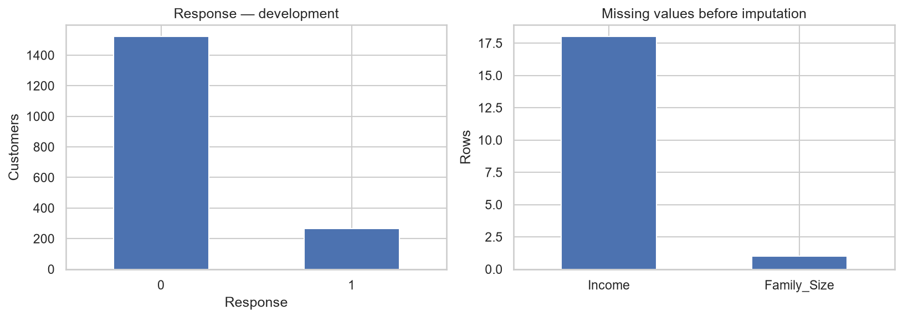
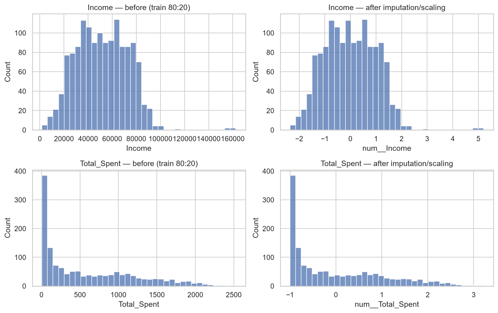
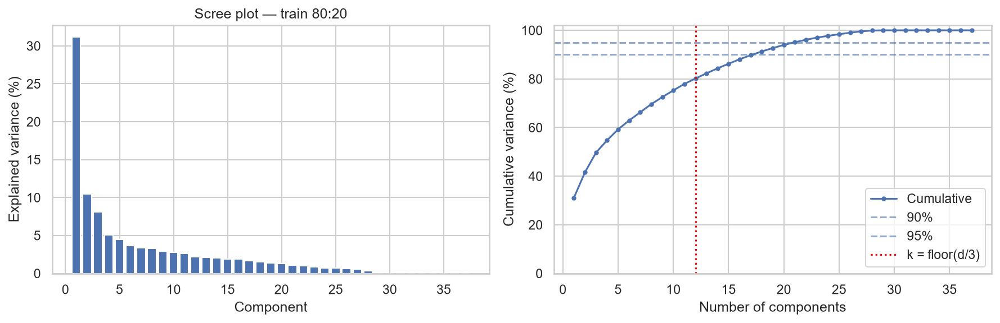
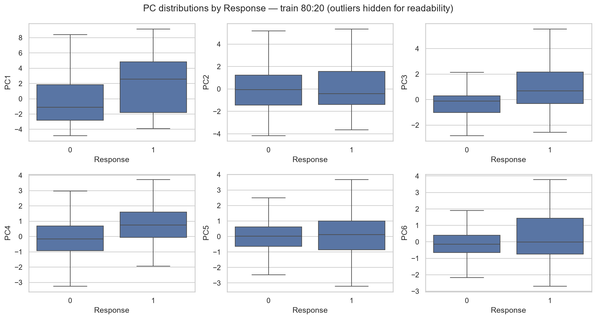
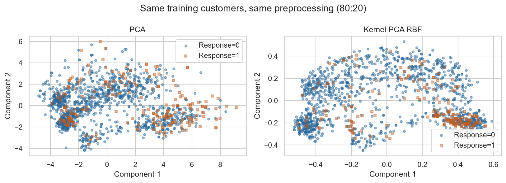
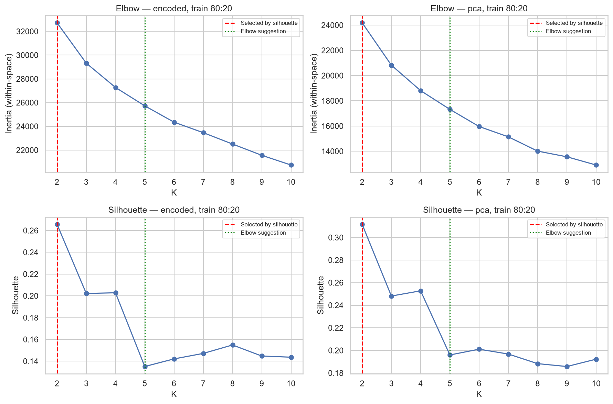
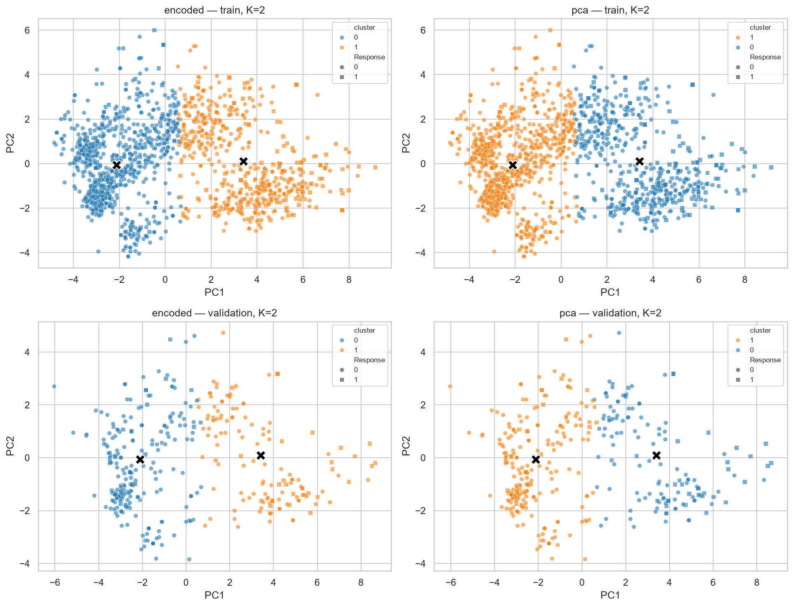
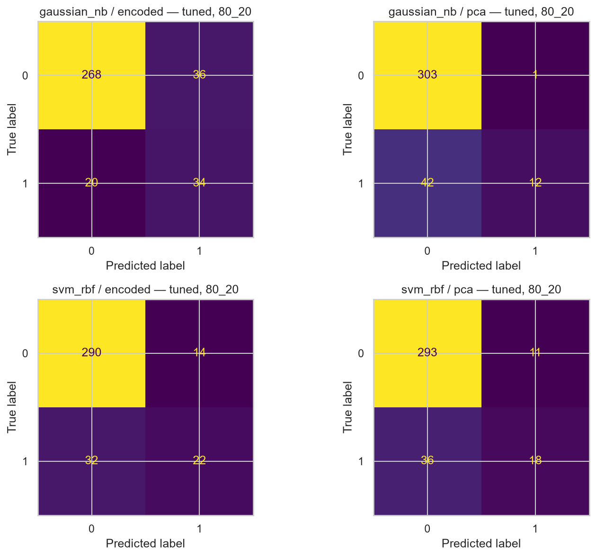
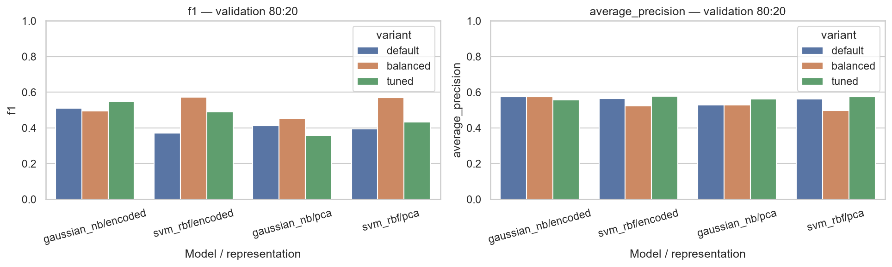
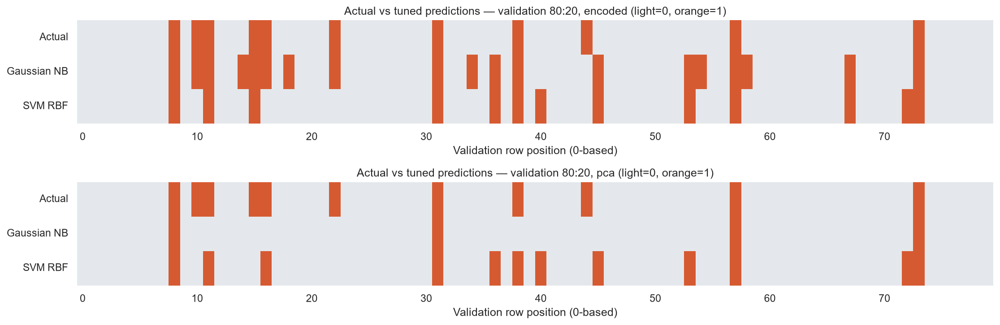

# Phân nhóm khách hàng và dự đoán hưởng ứng chiến dịch marketing

**Báo cáo giữa kỳ môn Machine Learning**  
**Thành viên:** ChinhBui và Tuananh  
**Ngày cập nhật:** 15/11/2026

Bản thảo trình bày bài toán, dữ liệu, phương pháp và kết quả thực nghiệm giữa kỳ.
Nội dung phân loại chính gồm Gaussian Naïve Bayes và SVM RBF. Logistic Regression
đã có kết quả bổ sung; phần chuyển bài toán sang hồi quy được dành cho cuối kỳ.
Họ tên chính thức, MSSV, lớp và giảng viên cần được nhóm bổ sung trước khi nộp.

## Tóm tắt

Nhóm sử dụng bộ Customer Personality Analysis để phân nhóm khách hàng theo đặc
điểm nhân khẩu và hành vi mua sắm, đồng thời dự đoán nhãn hưởng ứng chiến dịch
marketing cuối cùng. Dữ liệu ban đầu có 2.240 mẫu và 29 trường. Sau quy tắc làm
sạch cố định, còn 2.236 mẫu. Nhóm giữ riêng 448 mẫu test và thực nghiệm trên
1.788 mẫu development, với ba tỷ lệ train:validation là 80:20, 70:30 và 60:40.

Tiền xử lý tạo 37 đặc trưng sau mã hóa. PCA giảm xuống 12 thành phần, giữ khoảng
80% phương sai của không gian đầu vào đã xử lý. Phần phân tích so sánh PCA và
Kernel PCA RBF sử dụng cùng mẫu train 80:20 và cùng 6 thành phần. K-Means chọn
hai cụm theo Silhouette train; các nhóm khác nhau về thu nhập, chi tiêu và tỷ lệ
Response nhưng không trùng hoàn toàn với hai lớp nhãn.

NB và SVM được đánh giá trên cả đầu vào chưa giảm chiều và PCA, có các cấu hình
mặc định, cân bằng lớp và hiệu chỉnh. PCA không cải thiện đồng đều mọi chỉ số.
SVM vẫn có dấu hiệu overfit sau hiệu chỉnh; NB còn hạn chế về giả định phân phối
và độc lập của các đặc trưng. Kết quả hiện tại phục vụ so sánh thực nghiệm trên
validation, chưa phải đánh giá triển khai hay bằng chứng về hiệu quả marketing
trong thực tế.

## 1 Giới thiệu bài toán

Chiến dịch marketing thường cần lựa chọn nhóm khách hàng có khả năng quan tâm
để phân bổ nguồn lực liên hệ. Bài toán của nhóm có hai mục tiêu liên quan nhưng
khác nhau. Phân cụm tìm các nhóm có hồ sơ tương tự mà không sử dụng nhãn hưởng
ứng khi học. Phân loại dùng các nhãn đã biết để dự đoán Response cho khách hàng
mới trong cùng bối cảnh dữ liệu.

Đầu vào bao gồm các biến nhân khẩu, thu nhập, thành phần hộ gia đình, thời gian
gắn bó, chi tiêu, kênh mua sắm và lịch sử chiến dịch. Đầu ra Response bằng 1 nếu
khách hàng hưởng ứng chiến dịch cuối, bằng 0 trong trường hợp còn lại. Nhóm xem
các cột AcceptedCmp1 đến AcceptedCmp5 là thông tin lịch sử có trước chiến dịch
đích. Giả định thời điểm này cần được xác minh nếu áp dụng mô hình vào một hệ
thống marketing thực tế.

Nhãn mất cân bằng: 334/2.240 mẫu gốc có Response=1, khoảng 14,9%. Một mô hình
luôn đoán không hưởng ứng có thể đạt Accuracy cao nhưng bỏ sót toàn bộ khách
hàng hưởng ứng. Vì vậy, đánh giá cần bao gồm Precision, Recall, F1 và các độ đo
dựa trên điểm dự đoán, đồng thời giải thích lỗi FP và FN.

Phạm vi giữa kỳ bao gồm tiền xử lý, hai phương pháp giảm chiều, K-Means và hai
mô hình phân loại chính. Cuối kỳ nhóm sẽ trình bày đầy đủ Logistic, bổ sung bài
toán hồi quy từ điểm phân lớp và hoàn thiện so sánh tổng thể theo đề.

## 2 Dữ liệu và tiền xử lý

### 2.1 Nguồn và cấu trúc

Dữ liệu lấy từ [Customer Personality Analysis trên Kaggle](https://www.kaggle.com/datasets/imakash3011/customer-personality-analysis).
File `marketing_campaign.csv` phân tách bằng tab. Các nhóm trường gồm thông tin
khách hàng, thu nhập và hộ gia đình, số tiền mua các loại sản phẩm, số lần mua
qua từng kênh và thông tin phản hồi chiến dịch. Danh mục trường chi tiết nằm ở
`results/tables/data_dictionary.csv`.

ID chỉ phục vụ truy vết, không đưa vào mô hình. Z_CostContact và Z_Revenue là
cột hằng nên bị loại. Nhãn Response và các trường metadata cũng không tham gia
ma trận đặc trưng. Việc loại định danh tránh để mô hình học từ số mã khách hàng
không có ý nghĩa dự đoán trong thiết kế bài toán.

### 2.2 Quy tắc làm sạch và tạo đặc trưng

Nhóm sử dụng quy tắc cố định: loại Year_Birth nhỏ hơn 1920 và Income lớn hơn
200.000. Có ba mẫu vi phạm năm sinh và một mẫu vi phạm thu nhập, còn 2.236 mẫu.
Các ngưỡng này là quyết định làm sạch theo miền dữ liệu, không phải ngưỡng học
từ validation. Không loại thêm điểm chỉ vì làm giảm chỉ số của mô hình.

Income còn 24 giá trị thiếu sau làm sạch và được giữ nguyên đến bước imputation
trên train. Trạng thái hôn nhân bất thường được đưa vào nhóm Unknown thay vì
suy đoán một trạng thái cụ thể. Family_Size còn bốn giá trị thiếu liên quan đến
trường hợp không xác định được cấu trúc gia đình, cũng được impute trên train.

Đặc trưng mới mô tả tuổi, thời gian gắn bó, tổng chi tiêu, tổng số lần mua,
thành phần hộ gia đình và lịch sử chấp nhận chiến dịch. Ngày tham chiếu cố định
là 30/06/2014; dùng ngày chạy chương trình sẽ làm tuổi và thời gian gắn bó thay
đổi giữa hai lần thực nghiệm. Total_Purchases chỉ cộng các kênh mua hàng, không
cộng thêm NumDealsPurchases như một kênh thứ tư vì mua giảm giá có thể đã nằm
trong các kênh đó.

Sau bước này có 31 đặc trưng, gồm 29 cột số và hai cột phân loại. Các biến tổng
có thể tương quan với các biến thành phần; nhóm giữ chúng để mô tả hành vi nhưng
nêu ảnh hưởng đến giả định độc lập của NB khi đánh giá mô hình.

### 2.3 Nhóm trùng và chia dữ liệu

Các khách hàng khác ID có thể có cùng hồ sơ đặc trưng. Nhóm không xóa các khách
hàng này một cách tùy ý mà gán `duplicate_group` từ X, không dùng Response.
Nhóm trùng luôn nằm trọn trong một tập, kể cả khi cross-validation. Cách này
giảm khả năng đánh giá quá lạc quan do một hồ sơ xuất hiện ở cả phần học và phần
đánh giá.

Test cuối chiếm xấp xỉ 20% dữ liệu sạch. Ba tỷ lệ bắt buộc trong đề áp dụng
trong development, không chia lại toàn bộ dữ liệu cho mỗi mô hình. Giữ seed 42
và dùng cùng chỉ số dòng giữa các mô hình, trước và sau PCA.

<!-- table:splits -->
| partition | rows | response_0 | response_1 |
| --- | --- | --- | --- |
| development | 1788 | 1521 | 267 |
| test | 448 | 381 | 67 |
| train_80_20 | 1430 | 1217 | 213 |
| validation_80_20 | 358 | 304 | 54 |
| train_70_30 | 1250 | 1064 | 186 |
| validation_70_30 | 538 | 457 | 81 |
| train_60_40 | 1072 | 912 | 160 |
| validation_60_40 | 716 | 609 | 107 |
<!-- end:splits -->

Các tập chia được lưu cùng manifest chứa hash. Notebook xác minh hash và thời
gian sửa file trước/sau thực nghiệm. Test không được fit, transform hoặc dự đoán
trong phần giữa kỳ. Tuy nhiên, các khảo sát tổng quan trước khi chốt quy trình
đã từng xem dữ liệu; vì vậy nhóm chỉ khẳng định test được đóng băng từ lúc chốt,
không khẳng định test hoàn toàn chưa từng được quan sát.

### 2.4 Pipeline học riêng trên train

Cột số được điền khuyết bằng median train và chuẩn hóa bằng StandardScaler.
Cột category được điền giá trị thường gặp trên train và one-hot; mức mới trên
validation được xử lý bằng `handle_unknown='ignore'`. Các cột one-hot giữ giá
trị 0/1, không chuẩn hóa riêng như cột số. Pipeline thu được 37 cột đầu vào.

PCA được đặt sau bước tiền xử lý. Với cross-validation, mỗi fold tự fit imputer,
encoder, scaler và PCA bằng fold train. Nếu biến đổi trước toàn bộ train rồi
mới CV, thống kê của fold đánh giá có thể tham gia vào phép biến đổi. Pipeline
giúp giữ đúng thứ tự này và áp dụng cùng phép biến đổi đã học lên validation.

## 3 Cơ sở phương pháp

### 3.1 PCA

PCA tìm các phương trực giao giữ phương sai lớn nhất của dữ liệu đã căn giữa.
Nếu Z là ma trận đã xử lý và căn giữa, khai triển SVD của Z cung cấp các phương
chiếu. Chiếu lên k phương đầu tạo biểu diễn k chiều. Tỷ lệ phương sai của mỗi
thành phần bằng trị riêng tương ứng chia tổng trị riêng. PCA dùng X mà không
dùng nhãn, nên hướng có phương sai lớn không nhất thiết là hướng dự đoán
Response tốt nhất. Xem [tài liệu PCA](https://scikit-learn.org/stable/modules/generated/sklearn.decomposition.PCA.html).

Trong project, nhánh phân loại giữ `k=max(1,floor(d/3))`, với d là số cột sau mã
hóa trên train. d=37 nên k=12. Đây là quy tắc số chiều theo kế hoạch, không phải
k được chọn lại bằng điểm validation. Hình minh họa hai trục đầu và phân tích
sáu thành phần phục vụ trực quan, không thay cho ma trận 12 chiều của mô hình.

### 3.2 Kernel PCA RBF

Kernel PCA xây dựng ma trận tương đồng RBF với phần tử
`K(i,j)=exp(-gamma * ||x_i-x_j||²)`, định tâm ma trận rồi phân tích trị riêng.
Phương pháp cho phép biểu diễn quan hệ phi tuyến thông qua kernel. Project cố
định gamma=1/37 dựa vào số chiều, không dò bằng nhãn. Sáu thành phần dùng cho
phân tích và trực quan. Xem [tài liệu KernelPCA](https://scikit-learn.org/stable/modules/generated/sklearn.decomposition.KernelPCA.html).

Với n mẫu train, phương sai thành phần kernel i là `lambda_i/(n-1)`; tỷ lệ là
`lambda_i/trace(Kc)`, trong đó Kc là toàn bộ kernel đã định tâm. Không chia cho
tổng sáu trị riêng giữ lại vì như vậy sáu thành phần luôn cộng thành 100%.
Tỷ lệ này thuộc không gian kernel, khác tỷ lệ phương sai đầu vào của PCA.

### 3.3 K-Means

K-Means luân phiên gán mẫu về tâm gần nhất và cập nhật tâm để giảm tổng bình
phương khoảng cách trong cụm. Nhóm thử K từ 2 đến 10 với n_init=10, seed 42.
Elbow cho một gợi ý từ đường inertia; quy tắc chọn chính là Silhouette train
lớn nhất. Response không tham gia việc fit hoặc chọn K, chỉ dùng mô tả sau khi
đã có cụm. Xem [tài liệu KMeans](https://scikit-learn.org/stable/modules/generated/sklearn.cluster.KMeans.html).

### 3.4 Gaussian Naïve Bayes

NB phân loại bằng cách kết hợp prior lớp với likelihood các đặc trưng dưới
giả định độc lập có điều kiện theo lớp. Gaussian NB dùng phân phối Gaussian cho
từng đặc trưng trong mỗi lớp. Đây là cách tiếp cận sinh. Thư viện thực hiện ước
lượng tham số và tính điểm lớp; nhóm cần giải thích được vai trò prior, mean,
variance và giả định độc lập khi bảo vệ.

Project giữ Gaussian NB làm mô hình chính, nhưng các cột one-hot và cột nhị
phân không có phân phối Gaussian. Các biến chi tiêu tổng và thành phần cũng
không độc lập. PCA làm các trục không tương quan trên train nhưng không bảo đảm
độc lập hay Gaussian trong từng lớp. `var_smoothing` ổn định phương sai, không
sửa được các giả định đó. [Tài liệu GaussianNB](https://scikit-learn.org/stable/modules/generated/sklearn.naive_bayes.GaussianNB.html).

### 3.5 SVM RBF

SVM học ranh giới phân biệt với sự đánh đổi giữa biên phân lớp và vi phạm trên
tập học. Kernel RBF cho phép ranh giới phi tuyến. C điều khiển mức phạt vi phạm;
gamma điều khiển phạm vi ảnh hưởng của từng mẫu. C lớn và gamma lớn có thể làm
mô hình bám sát train, cần kiểm tra bằng CV và chênh lệch train–validation.
Project dùng decision margin để tính ROC/PR; margin không phải xác suất hưởng
ứng. [Tài liệu SVC](https://scikit-learn.org/stable/modules/generated/sklearn.svm.SVC.html).

## 4 Kết quả giảm chiều

### 4.1 PCA theo ba tỷ lệ

<!-- table:pca -->
| split | retained_components | retained_variance_ratio | components_for_90pct | components_for_95pct |
| --- | --- | --- | --- | --- |
| 80_20 | 12 | 0.8017 | 18 | 21 |
| 70_30 | 12 | 0.8020 | 18 | 21 |
| 60_40 | 12 | 0.8049 | 18 | 21 |
<!-- end:pca -->

PCA 12 chiều giữ khoảng 80,17–80,49% phương sai trong ba tập train. Cả ba trường
hợp cần 18 thành phần để đạt 90% và 21 thành phần để đạt 95%. Phần phương sai bị
loại có thể chứa thông tin phân loại, nên không thể suy ra Accuracy hay Recall
sẽ tăng chỉ từ explained variance.

Các bảng `pca_*_train_statistics.csv` và `pca_*_validation_statistics.csv` ghi
mean, std, skewness, min, median và max. Mean các PC train gần 0, std bằng căn
bậc hai trị riêng mẫu. Skewness đánh giá độ bất đối xứng, không phải kiểm định
đầy đủ về phân phối Gaussian.

Hình cặp sáu thành phần đầu gồm 15 cặp; boxplot biểu diễn phân phối theo nhãn.
PC1 gắn mạnh với thu nhập và chi tiêu; các PC tiếp theo phản ánh thêm cấu trúc
hộ gia đình và lịch sử chiến dịch. Hệ số chiếu là trọng số của đặc trưng đã xử
lý, không phải hệ số tương quan trực tiếp. Dấu trục có thể đảo mà không thay
đổi hình học và lượng phương sai giữ lại.

### 4.2 So sánh PCA và Kernel PCA trên cùng dữ liệu

Hai phương pháp sử dụng chung 1.430 mẫu train, cùng preprocessing đã fit và
cùng sáu thành phần. Validation gồm 358 mẫu, chỉ được transform. Việc đồng nhất
mẫu tránh nhầm thay đổi do tập dữ liệu với thay đổi do phương pháp.

<!-- table:reduction -->
| method | partition | rows | components | trustworthiness_10 |
| --- | --- | --- | --- | --- |
| PCA | train | 1430 | 6 | 0.9765 |
| Kernel PCA RBF | train | 1430 | 6 | 0.9479 |
| PCA | validation | 358 | 6 | 0.9667 |
| Kernel PCA RBF | validation | 358 | 6 | 0.9295 |
<!-- end:reduction -->

Sáu PC giữ 62,93% phương sai đầu vào đã xử lý; sáu thành phần Kernel PCA giữ
39,21% phương sai kernel. Hai con số không dùng để xếp hạng trực tiếp. Để có
một đối chiếu chung, nhóm dùng trustworthiness@10: đo mức bảo toàn láng giềng
so với chính ma trận 37 chiều. Chỉ số nằm trong [0,1], cao hơn biểu thị ít
láng giềng mới không phù hợp hơn. [Định nghĩa trustworthiness](https://scikit-learn.org/stable/modules/generated/sklearn.manifold.trustworthiness.html).

Trong cấu hình hiện tại, PCA có trustworthiness cao hơn trên cả train và
validation: khoảng 0,977/0,967 so với 0,948/0,930 của Kernel PCA. Kết quả chỉ áp
dụng cho sáu chiều và gamma=1/37; không chứng minh PCA luôn tốt hơn mọi Kernel
PCA, cũng không phải kết quả so sánh bộ phân loại.

KPCA3 có tương quan tuyệt đối với Response lớn nhất trong sáu thành phần train,
khoảng 0,298. Median KPCA3 của lớp 1 khoảng 0,160 và lớp 0 khoảng −0,040 theo
hướng dấu của lần chạy này. Các nhóm vẫn chồng lấn. Nhóm báo cáo quan hệ này
sau khi fit, không dùng nó để chọn gamma hay dùng nhãn để học phép chiếu.

PCA thuận lợi hơn về diễn giải hệ số trên đặc trưng đầu vào. Kernel PCA có khả
năng biểu diễn phi tuyến nhưng khó quy mỗi trục về một tổ hợp tuyến tính đơn
giản của đặc trưng gốc, phụ thuộc gamma và cần lưu thông tin train để chiếu mẫu
mới. Nhánh phân loại giữa kỳ tiếp tục dùng PCA 12 chiều theo kế hoạch chung.

## 5 Kết quả phân cụm

Quy tắc Silhouette chọn K=2 trong sáu kịch bản gồm ba tập chia và hai biểu diễn.
Elbow gợi ý K=5; vì đường inertia không có một điểm gãy quyết định rõ ràng,
nhóm giữ quy tắc chọn đã định trước thay vì chọn lại bằng nhãn Response.

Trên train 80:20 chưa PCA, Silhouette khoảng 0,266; trên validation khoảng
0,275. Nhánh PCA có Silhouette khoảng 0,312 và 0,323. Tuy nhiên, hai biểu diễn
có hình học khác nhau nên không coi việc điểm PCA cao hơn là chứng minh chất
lượng kinh doanh tốt hơn. Hình chiếu còn chồng lấn cho thấy độ tách cụm hạn chế.

<!-- table:clusters -->
| cluster | rows | response_1 | response_rate |
| --- | --- | --- | --- |
| 0 | 882 | 85 | 0.0964 |
| 1 | 548 | 128 | 0.2336 |
<!-- end:clusters -->

Cụm 0 gồm 882 mẫu train, median Income khoảng 38.774,5 và Total_Spent khoảng
97,5; tỷ lệ hưởng ứng 9,64%. Cụm 1 gồm 548 mẫu, median Income khoảng 71.613 và
Total_Spent khoảng 1.170,5; tỷ lệ hưởng ứng 23,36%. Các tỷ lệ gợi ý quan hệ giữa
nhóm hành vi và nhãn, không thể hiện quan hệ nhân quả. Số thứ tự cụm chỉ là mã
gán, có thể đảo giữa các lần fit.

Đối chiếu nhiều seed cho thấy phân hoạch khá ổn định trên mẫu hiện có. Việc
phân cụm không tạo ra bộ phân loại Response: mỗi cụm vẫn chứa cả hai nhãn.
GMM/DBSCAN là phần mở rộng theo phân công, chưa được dùng để đưa ra kết luận
so sánh ở bản giữa kỳ này.

## 6 Thiết kế thực nghiệm phân loại

Hai mô hình chính chạy trên ba tỷ lệ và hai biểu diễn, tổng cộng 12 cấu hình.
Mỗi cấu hình có bản mặc định, cân bằng lớp và tuned. Với hai tập train và
validation, bảng tổng hợp chứa 72 dòng độ đo.

NB dò sáu mức `var_smoothing` từ 1e-11 đến 1e-1 và hai chế độ trọng số. SVM dò
C trong {0,1; 1; 10; 100}, gamma trong {scale; 0,01; 0,1} và hai chế độ trọng số.
Trọng số NB được tính lại từ nhãn của fold train ngay trong fit. SVM dùng
`class_weight='balanced'` ở cấu hình cân bằng. Không thay đổi phân phối nhãn
validation để làm điểm số đẹp hơn.

Mỗi tìm kiếm dùng 5-fold StratifiedGroupKFold và chọn theo AP trung bình.
Sau đó mô hình tốt nhất được fit lại trên toàn train, đánh giá validation ở
ngưỡng cố định. Chọn theo AP nên không bảo đảm F1 tại ngưỡng mặc định lớn nhất.
Không dò lại ngưỡng hoặc tham số từ kết quả validation đã nhìn thấy.

Precision trả lời trong các khách hàng dự đoán hưởng ứng, bao nhiêu người thực
sự hưởng ứng. Recall trả lời mô hình tìm được bao nhiêu trong số người thực sự
hưởng ứng. F1 kết hợp hai chỉ số tại ngưỡng. ROC-AUC và PR-AUC dùng điểm liên
tục; PR-AUC ở project là diện tích hình thang, AP là đại lượng riêng dùng chọn
tham số. FP gây liên hệ không hiệu quả; FN bỏ sót khách hàng hưởng ứng.

## 7 Kết quả Naïve Bayes và SVM

### 7.1 Đối chiếu tại tỷ lệ 80:20

Validation có 358 khách hàng, gồm 54 người hưởng ứng. Dự đoán toàn 0 đạt
Accuracy 84,92% nhưng Recall/F1 lớp 1 bằng 0. Vì vậy, bảng dưới ưu tiên đọc
Precision, Recall, F1, PR-AUC và FP/FN cùng nhau.

<!-- table:classification80 -->
| model | space | precision | recall | f1 | pr_auc | average_precision | fp | fn |
| --- | --- | --- | --- | --- | --- | --- | --- | --- |
| Gaussian NB | 37 chiều | 0.4857 | 0.6296 | 0.5484 | 0.5627 | 0.5580 | 36 | 20 |
| SVM RBF | 37 chiều | 0.6111 | 0.4074 | 0.4889 | 0.5745 | 0.5787 | 14 | 32 |
| Gaussian NB | PCA 12 | 0.9231 | 0.2222 | 0.3582 | 0.5595 | 0.5628 | 1 | 42 |
| SVM RBF | PCA 12 | 0.6207 | 0.3333 | 0.4337 | 0.5700 | 0.5757 | 11 | 36 |
<!-- end:classification80 -->

NB tuned chưa PCA đạt Recall khoảng 0,630 và F1 khoảng 0,548, nhưng có 36 FP.
Sau PCA, Precision tăng lên khoảng 0,923, trong khi Recall giảm còn 0,222 và
có 42 FN. Nhánh PCA đưa ra ít dự đoán dương hơn ở ngưỡng đang dùng, nên độ chính
xác của các dự đoán dương cao nhưng bỏ sót nhiều khách hàng.

SVM tuned chưa PCA có F1 khoảng 0,489, Recall 0,407; nhánh PCA có F1 khoảng
0,434, Recall 0,333. AP hai nhánh gần nhau tại tỷ lệ này, khoảng 0,579 và 0,576.
Tín hiệu xếp hạng và chất lượng nhãn cứng ở ngưỡng cố định là hai khía cạnh cần
phân biệt khi nhận xét.

### 7.2 Ảnh hưởng của tỷ lệ chia và PCA

<!-- table:classification_all -->
| split | model | space | f1 | average_precision | roc_auc |
| --- | --- | --- | --- | --- | --- |
| 80_20 | Gaussian NB | 37 chiều | 0.5484 | 0.5580 | 0.7904 |
| 80_20 | SVM RBF | 37 chiều | 0.4889 | 0.5787 | 0.8666 |
| 80_20 | Gaussian NB | PCA 12 | 0.3582 | 0.5628 | 0.8210 |
| 80_20 | SVM RBF | PCA 12 | 0.4337 | 0.5757 | 0.8579 |
| 70_30 | Gaussian NB | 37 chiều | 0.5444 | 0.5557 | 0.8281 |
| 70_30 | SVM RBF | 37 chiều | 0.5895 | 0.5428 | 0.8668 |
| 70_30 | Gaussian NB | PCA 12 | 0.4286 | 0.5593 | 0.8535 |
| 70_30 | SVM RBF | PCA 12 | 0.5000 | 0.6348 | 0.8763 |
| 60_40 | Gaussian NB | 37 chiều | 0.5211 | 0.5225 | 0.8011 |
| 60_40 | SVM RBF | 37 chiều | 0.5645 | 0.6255 | 0.8874 |
| 60_40 | Gaussian NB | PCA 12 | 0.3784 | 0.5437 | 0.8385 |
| 60_40 | SVM RBF | PCA 12 | 0.4886 | 0.5913 | 0.8651 |
<!-- end:classification_all -->

PCA không làm F1 của NB tăng trong các cấu hình tuned đã chạy, dù AP có thể
thay đổi theo chiều khác. Với SVM, hiệu ứng giảm chiều thay đổi theo tỷ lệ và
chỉ số. Các validation có kích thước khác nhau và chồng lấn theo thiết kế tập
chia; không xem ba tỷ lệ như ba phép lặp độc lập để tính độ tin cậy thống kê.

Một số cấu hình balanced có Recall cao hơn tuned ở ngưỡng cố định. Điều này
không mâu thuẫn với việc chọn tuned bằng AP trong CV, vì mục tiêu chọn tham số
khác Recall/F1 của một validation cụ thể. Các đường ROC/PR và bảng kết quả đầy
đủ nằm trong notebook 04 và thư mục kết quả phân loại.

### 7.3 Overfit và hiệu chỉnh

<!-- table:gaps -->
| model | space | train_average_precision | average_precision | train_minus_validation_average_precision |
| --- | --- | --- | --- | --- |
| Gaussian NB | 37 chiều | 0.4718 | 0.5580 | -0.0862 |
| SVM RBF | 37 chiều | 0.8935 | 0.5787 | 0.3148 |
| Gaussian NB | PCA 12 | 0.5354 | 0.5628 | -0.0274 |
| SVM RBF | PCA 12 | 0.7669 | 0.5757 | 0.1912 |
<!-- end:gaps -->

SVM tuned chưa PCA tại 80:20 có AP train khoảng 0,894 và validation khoảng
0,579, chênh khoảng 0,315. Sau PCA, chênh lệch còn khoảng 0,191. Kết quả này
cho thấy dấu hiệu overfit vẫn còn, không thể gọi mô hình đã hết overfit chỉ vì
đã chạy GridSearchCV.

Ở phép đối chiếu SVM chưa PCA, giữ gamma=scale và không cân bằng lớp, CV AP
train/fold-validation khi C=100 xấp xỉ 0,980/0,566; khi C=1 xấp xỉ 0,885/0,660.
Giảm C trong đối chiếu này làm giảm chênh lệch và cải thiện điểm fold đánh giá.
Cấu hình cuối cùng còn phụ thuộc gamma, nên không kết luận mọi C nhỏ hơn đều
tốt hơn. Với NB, tăng var_smoothing ổn định phương sai nhưng không khắc phục
giả định Gaussian của cột one-hot. Cân bằng lớp cũng không phải regularization
trực tiếp, mà thay đổi mức quan tâm đối với các lớp.

### 7.4 Dự đoán so với thực tế và độ phù hợp

Hình dưới dùng 80 khách hàng đầu của validation 80:20 theo thứ tự đã lưu,
không lựa chọn các mẫu mô hình dự đoán đúng. Mỗi cột đối chiếu nhãn thật và nhãn
NB/SVM. Kết luận chính vẫn dựa trên toàn bộ 358 mẫu trong confusion matrix.

NB là mốc so sánh gọn, có thể phát hiện một phần lớp hưởng ứng, nhưng chưa có
cơ sở coi giả định phân phối phù hợp hoàn toàn. Đặc biệt, NB sau PCA ở ngưỡng
hiện tại bỏ sót nhiều lớp 1. SVM RBF mô tả ranh giới phi tuyến và có khả năng
xếp hạng hữu ích trong các kết quả validation, song khoảng cách train–validation
còn lớn. Cả hai cần được đánh giá theo chi phí FP/FN cụ thể trước khi quyết định
sử dụng trong thực tế. Nhóm chưa có thông tin chi phí hoặc thử nghiệm kinh doanh
để xác định mô hình tối ưu cho triển khai.

## 8 Logistic và kế hoạch cuối kỳ

Tuananh đã triển khai Logistic Regression với ba tỷ lệ, hai biểu diễn và hai
chế độ trọng số, dò C cùng L1/L2 bằng group-CV. Bảng Logistic gồm 24 dòng
train/validation. Nhãn `class_weight=default` chỉ có nghĩa không cân bằng lớp;
cấu hình C và penalty vẫn đã được tối ưu. Bảng ba mô hình không giả định các
ngân sách tìm kiếm tham số hoàn toàn giống nhau.

Theo kế hoạch thuyết trình giữa kỳ, phần chính chỉ trình bày NB và SVM. Logistic
được giữ làm phần bổ sung và sẽ được trình bày đầy đủ ở cuối kỳ. Mã tạo xác suất
ngoài fold của Logistic đã có; việc xuất điểm và huấn luyện các mô hình hồi quy
chưa thuộc nội dung hoàn thành giữa kỳ.

Ở mục 2.4(c), nhóm sẽ dùng xác suất lớp Response=1 từ mô hình nguồn làm đầu ra
liên tục. ChinhBui làm KNN Regressor hoặc MLP Regressor; Tuananh làm Linear/Ridge.
Hai người dùng chung đầu ra và tập chia, chạy cả 37 chiều và PCA 12 chiều, báo
cáo RMSE, MAE và R². Đây là học lại điểm của mô hình nguồn, không được diễn giải
RMSE thấp là đã chứng minh xác suất hưởng ứng thực tế được ước lượng chính xác.

## 9 Kết luận và hạn chế

Nhóm đã xây dựng quy trình tiền xử lý và thực nghiệm có kiểm soát tập chia, có
hai phương pháp giảm chiều và kết quả phân cụm. Phân loại giữa kỳ có đầy đủ
kịch bản NB/SVM trên ba tỷ lệ và trước/sau PCA. Kết quả cho thấy giảm chiều giúp
biểu diễn gọn nhưng không bảo đảm cải thiện phân loại; cân bằng lớp thay đổi
đánh đổi Precision–Recall; SVM vẫn cần được xem xét về overfit.

Các giới hạn gồm quy mô dữ liệu nhỏ, lớp hưởng ứng ít, giả định thời điểm của
đặc trưng, các biến tương quan, chưa đánh giá test cuối và chưa đánh giá lợi ích
kinh doanh. Kernel PCA mới xét gamma định trước. Tỷ lệ phương sai giữa PCA và
Kernel PCA đo hai không gian khác nhau. Các kết quả do seed và thiết kế chia
hiện tại không đại diện cho mọi cách lấy mẫu hoặc mọi quần thể khách hàng.

Trước khi nộp, hai thành viên cần đọc duyệt số liệu, giải thích được mô hình
mình phụ trách và hoàn thiện định dạng tài liệu theo yêu cầu môn học. Không
đánh đồng các kiểm tra chương trình với việc thành viên đã hiểu và bảo vệ được
nội dung.

## Phụ lục A Phân công và tái lập

ChinhBui phụ trách làm sạch/thống kê, PCA, K-Means, NB/SVM và tích hợp kết quả
trình bày. Tuananh phụ trách pipeline dùng chung, Kernel PCA, Logistic và nguồn
đầu ra hồi quy. Hai thành viên cùng so sánh, viết mở đầu/kết luận và kiểm tra
chéo. Chi tiết nằm ở `docs/task_assignment.md`.

Chạy notebook 01, 02, 03, 04 theo thứ tự bằng đúng kernel đã cài dependencies.
Lệnh tự động: `python -X utf8 scripts/run_notebooks.py 01 02 03 04`.
Các kiểm tra: `python -m unittest discover -s tests -v`.
Môi trường cụ thể ghi ở `requirements-tested.txt`. File dữ liệu được tải theo
DATA_GUIDE, không đính kèm gói nộp. Bảng, hình và audit nằm trong `results/`.

## Phụ lục B Nguồn và bằng chứng kết quả

- Đề môn học: `Projects_ideas/Projects_Ideas.pdf`, mục 2.1–2.4 và yêu cầu giữa kỳ.
- Dữ liệu: Kaggle Customer Personality Analysis, liên kết ở mục 2.1.
- Mã và công thức thư viện: tài liệu scikit-learn liên kết ở từng phần phương pháp.
- Thống kê dữ liệu: `preprocessing_summary.json`, `data_split_summary.csv`.
- PCA: `pca_experiment_summary.csv`, `pca_*_statistics.csv`, `pca_*_variance.csv`.
- So sánh giảm chiều: `pca_kpca_comparison.csv`, `pca_kpca_audit.json`.
- Phân cụm: `kmeans_evaluation.csv`, `kmeans_*_summary.csv`.
- Phân loại: `classification_metrics.csv`, `classification_cv_selection.csv`,
  `classification_train_validation_gaps.csv`, `all_models_comparison.csv`.
- Chạy notebook: `notebook_execution_audit.json`; xác minh tập chia bằng manifest.

Các bảng được chèn từ file kết quả bằng `scripts/refresh_report_tables.py`.
Các nhận xét văn bản cần đọc lại nếu thay đổi dữ liệu hoặc cấu hình thực nghiệm.
